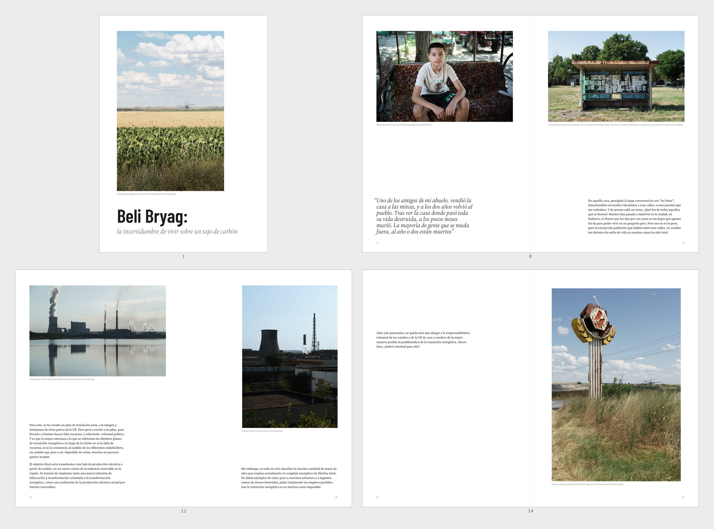
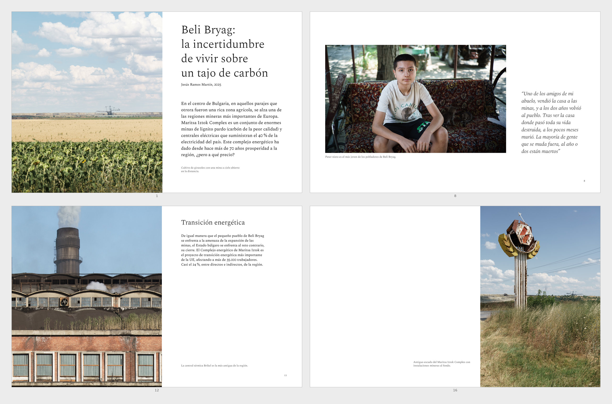
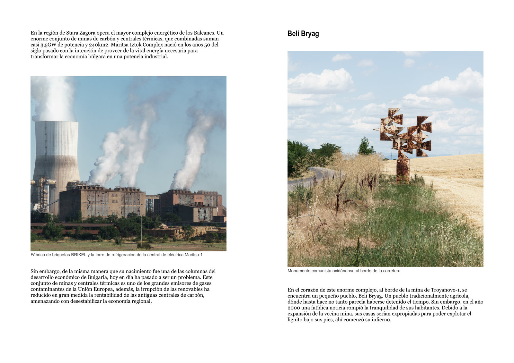
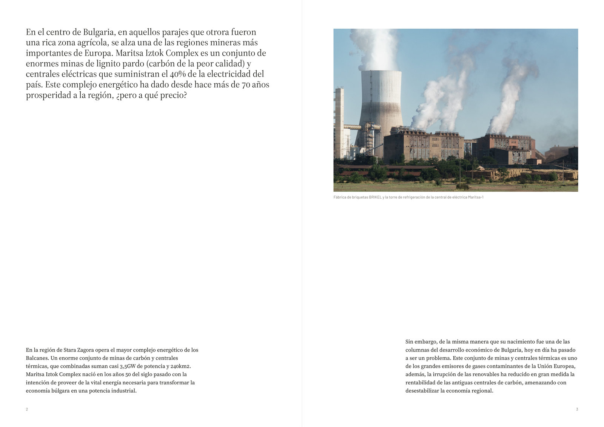
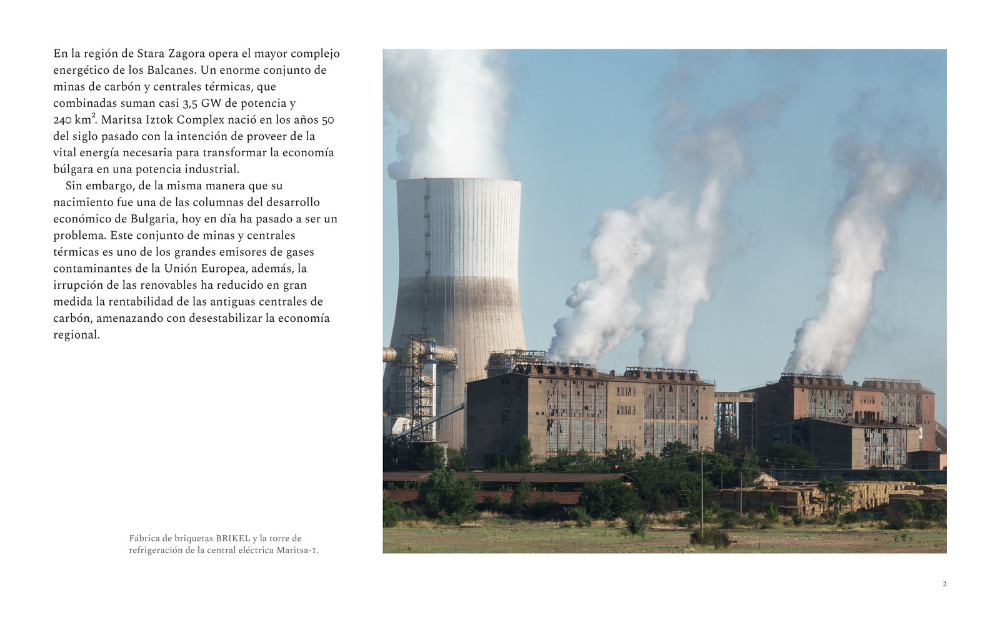
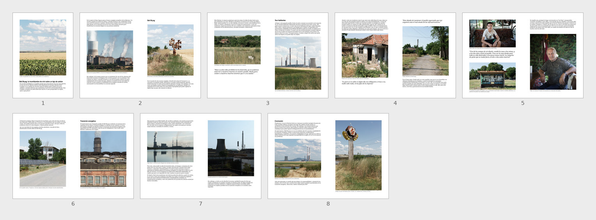
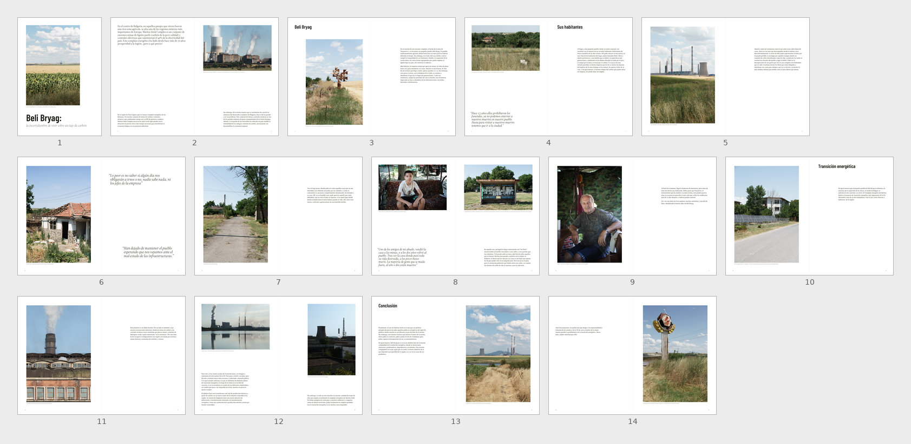
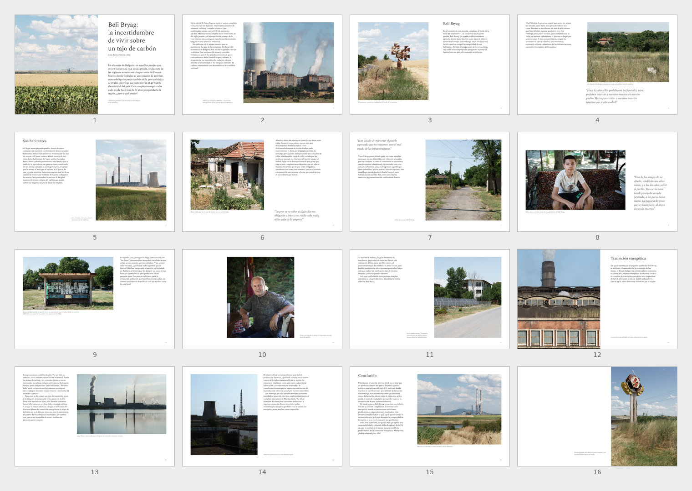

# Beli Bryag: with the skill, without it, and the original layout

*Beli Bryag: la incertidumbre de vivir sobre un tajo de carbón* is a photojournalism story by the author, featuring 16 photographs and around 1,700 words. Claude Opus 5.5, set to high reasoning effort, laid it out twice for on-screen reading using the exact same prompt: once with the skill and once without. The author's original layout, crafted by hand in Affinity Publisher, is included as a reference.

## The prompt

The same message in both sessions (slightly edited here):

> Quiero transformar *Beli Bryag* (la carpeta con el texto y las fotos del reportaje) en una obra bien maquetada. El contenido ha de ser invariable y no puede cambiarse bajo ningún concepto: ni el texto, ni las fotos, ni su orden. El caso es que la maquetación de ese texto y esas fotos, con ese orden, me parece muy mejorable. El objetivo es tener algo que pueda enseñar a la gente para mostrar mi trabajo.

> *English translation:*
> "I want to turn *Beli Bryag* (the folder with the story's text and photographs) into a well-designed piece. The content must stay unchanged under all circumstances: the text, the photos and their order. The layout of that text and those photos, in that order, could be much better. The goal is to have something I can show people to present my work."

## Four pages from each version

Without skill:

With skill:

## The same page across all three versions

The page where the same content block falls in each version. Click on any image to view it at 1600 px.

| Original author layout | Without skill | With skill |
|---|---|---|
|  |  |  |

## Contact sheets

All pages from each version, shown at the same thumbnail size across all sheets.

Author's original layout

Without skill

With skill

## Documents from the session with the skill

- [`programa_v01.md`](programa_v01.md): the design program for the document, approved by the author before typesetting.
- [`memoria_v01.md`](memoria_v01.md): the decision log.
- [`control_v01.md`](control_v01.md): the final quality control report.
- [`beli_bryag.typ`](beli_bryag.typ) and [`contenido.typ`](contenido.typ): the Typst code for the layout.
